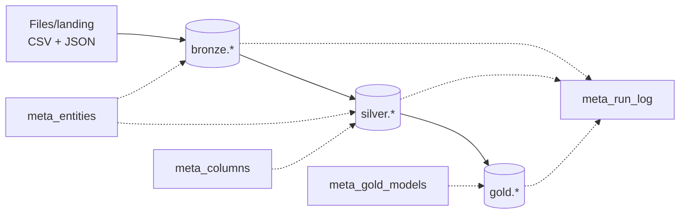
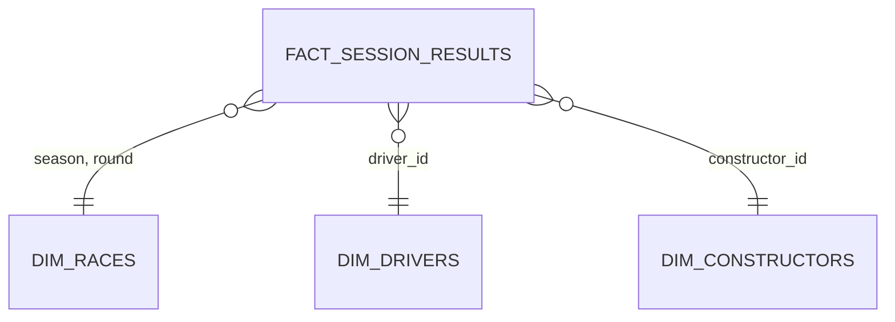

# Formula 1 Lakehouse: Metadata-Driven Medallion Pipeline on Microsoft Fabric

A batch ETL pipeline over Formula 1 race data, rebuilt from a 16-task Azure Databricks job into a **metadata-driven** design on Microsoft Fabric. Bronze, silver and gold layers are each driven by a few generic, parameterized notebooks that read their instructions from Delta config tables. Adding a table is a metadata change, not a code change.


## Why metadata-driven

The original Databricks project had one ingest task and one transform task per entity (circuits, races, constructors, drivers, results, sprints). The code was nearly identical across them; only paths, schemas and column names differed.

| | Original (Databricks) | This project (Fabric) |
|---|---|---|
| Orchestration | 16 hard-coded Lakeflow Job tasks | 1 pipeline: Lookup, Filter, ForEach, then gold |
| Notebooks at runtime | One per entity per layer | 3 generic notebooks |
| Add a new table | New notebooks and tasks, wire dependencies | Insert rows into config tables |
| Schema and rename logic | Hard-coded in each notebook | `meta_columns` |
| Gold logic | One notebook per model | SQL stored in `meta_gold_models` |
| Observability | None | `meta_run_log` (status, rows, timings, errors) |


## Architecture



**Stack:** Microsoft Fabric (Lakehouse with schemas, Data Pipelines, Notebooks), PySpark, Delta Lake, Spark SQL.

## Metadata tables

| Table | Purpose |
|---|---|
| `meta_entities` | One row per source: path (file or folder), format, multiline flag, business key, bronze table, write mode, active flag |
| `meta_columns` | One row per silver column: source column or SQL expression, target name, data type, optional transform (`initcap`, `upper`, ...) |
| `meta_gold_models` | One row per gold table: target table and the SQL that builds it |
| `meta_run_log` | One row per entity per layer per run: status, rows written, start and end time, error message |

`meta_entities` (excerpt):

| entity | source_path | file_format | multiline | primary_key | bronze_table |
|---|---|---|---|---|---|
| circuits | Files/landing/circuits.csv | csv | | circuit_id | bronze.circuits |
| drivers | Files/landing/drivers.json | json | false | driver_id | bronze.drivers |
| sprints | Files/landing/sprints | json | true | season,round,constructor_id,driver_id | bronze.sprints |

`meta_columns` (excerpt):

| entity | source_expr | target_col | data_type | transform |
|---|---|---|---|---|
| circuits | `lat` | `latitude` | double | |
| circuits | `circuitName` | `circuit_name` | string | initcap |
| drivers | `concat_ws(' ', name.givenName, name.familyName)` | `driver_name` | string | initcap |


## How each layer works

### Bronze: `nb_ingest_bronze`
Takes an `entity` parameter, reads its row from `meta_entities`, and loads the source as-is into `bronze.<entity>`.
- Handles **CSV and JSON** from a single file or a folder of files, including multi-line JSON.
- CSV is read with all columns as strings. JSON keeps Spark's inferred schema, so nested structs (such as `drivers.name`) are preserved.
- Adds audit columns: `ingestion_timestamp`, `source_file`, `batch_id`.

### Silver: `nb_transform_silver`
Takes an `entity` parameter and applies `meta_columns` to the bronze table.
- **Schema validation:** fails fast with a clear message if bronze is missing an expected column.
- Selects, renames and casts columns, and applies value transforms. Columns not listed in the metadata (such as `url`) are dropped.
- Drops rows with a null business key, then deduplicates on that key.
- Prints and logs row counts: bronze in, null-key rejects, duplicates removed, silver out.

### Gold: `nb_build_gold`
Runs every active model in `meta_gold_models` (or one, if a `model` parameter is passed). Each model is a SQL statement written to a Delta table.

| Model | Description |
|---|---|
| `dim_races` | Races joined to circuits |
| `dim_drivers` | Drivers with nationality region |
| `dim_constructors` | Constructors with nationality region |
| `fact_session_results` | Race and sprint results unioned, with `session_type`, `is_win`, `is_podium`, `has_points` |

`gold.ref_nationality_region` is a small static lookup built once.



## Orchestration

```
Get Entities (Lookup) -> Filter Active -> ForEach Entity -> Build Gold
                                          (bronze -> silver,
                                           up to 6 in parallel)
```

- The Lookup reads `meta_entities` and the Filter keeps rows where `is_active = 1`.
- The ForEach runs the bronze and silver notebooks for each entity, with entities in parallel.
- Gold runs once, after every entity has finished.
- `@pipeline().RunId` is passed as `batch_id`, so every log row and bronze row ties back to a pipeline run.


## Run observability

Every notebook writes to `meta_run_log`, including failures.


## Repository structure

```
.
├── notebooks/
│   ├── nb_setup_metadata.ipynb          # schemas, meta_entities, meta_run_log
│   ├── nb_setup_silver_metadata.ipynb   # meta_columns
│   ├── nb_setup_gold_metadata.ipynb     # ref_nationality_region, meta_gold_models
│   ├── nb_ingest_bronze.ipynb
│   ├── nb_transform_silver.ipynb
│   └── nb_build_gold.ipynb
├── docs/images/
└── README.md
```

## Running it

1. Create a schema-enabled Lakehouse named `formula1` and upload the raw files to `Files/landing/`.
2. Import the notebooks and attach the lakehouse as the default.
3. Run the three setup notebooks once.
4. Create the pipeline as described above and run it.

## Design decisions

- **Bronze stays raw.** CSV columns land as strings so bronze is a faithful copy of the source. Typing and validation happen in silver, where bad rows can be handled deliberately.
- **Business keys, not surrogate keys.** The source has no race ID, so races are keyed on `season` plus `round`, and results on season, round, constructor and driver. Keys live in metadata.
- **Special cases stay explicit.** The drivers name concatenation is a SQL expression in `meta_columns`, and the nationality lookup is a dedicated table, rather than forcing them into generic rules.
- **Gold as SQL in a table.** Joins and aggregations are readable, reviewable SQL, and the notebook only orchestrates them.

## Possible improvements

- Quarantine table for rows rejected in silver
- Incremental loads with watermarks and Delta MERGE (`write_mode` and `load_type` are already in the config)
- Power BI semantic model over the gold tables with Direct Lake
- Scheduled trigger and failure alerts
